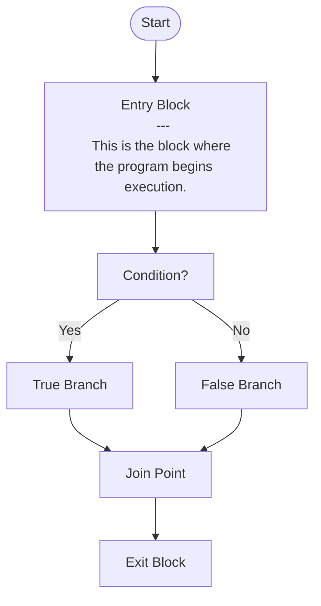

# Synergistic Program Analyzer (SPAN)

A program analysis engine and bug finder tool with its foundation in Abstract Interpretation and Data Flow Analysis.

Below is a simple Mermaid diagram illustrating a program's Control Flow Graph (CFG):

This example depicts the control flow of a program with a conditional branch. 
- The program starts at the "Entry Block".
- Encounters a condition ("Condition?").
- Depending on the condition, it takes either the "True Branch" or "False Branch".
- Both branches join at the "Join Point" before reaching the exit.
You can edit this diagram to reflect your own program's CFG structure using the [Mermaid syntax](https://mermaid.js.org/syntax/flowchart.html).

## The platform

SPAN is a program analysis engine written in Go programming language.
It uses the Clang/LLVM infrastructure to convert a C program to Clang AST 
and then to a three-address code intermediate represenation called SPIR (SPAN IR)
using the slang tool.

## What is SPAN IR (SPIR)?

SPIR is an simple three-address code intermediate representation (IR) which
is built to experiment with different program analysis abstractions and alogirthms.
The goal of SPIR is to provide an IR that lends itself efficiently
to program analysis, and to allow experimentation with different program
analysis algorithms and techniques.

## How is a C program converted to SPIR?

SPAN uses the Clang/LLVM based tool `slang` which converts an input C program
into a Clang AST, which is then visited and serialized to SPIR
using the specification in `spir.proto` protobuf file.
The output of `slang` is a binary/text protobuf message that becomes an input
to `span` program analyzer.

## How are C programs analyzed across files?

A single C file is converted to a single SPIR Translation Unit (SPIR TU or just TU).
SPAN supports a rudimentary static linker which can combine two or more TUs into one.
One can also use Clang's cross translation unit feature to create a single AST for the entire
project and convert that into a single SPIR TU (TODO).

## How to setup Docker container?

The project uses `.devcontainer/Dockerfile` and `.devcontainer/devcontainer.json` to configure
the docker container and set it up in the vscode/cursor development environment.

## What are the project design guidelines followed in SPAN?

SPAN is a modular project where each component is developed like a library which can be reused.
Our goal is to define simple components and compose them to achieve the functionality.
We extensively use the interface programming style as encouraged by the Go community.
Wherever possible, SPAN uses standard Go programming practices and SOLID programming
principles to develop a bug free and maintainable project.
You will find all implementation details hidden behind carefully created interfaces.

Suggestions and contributions are welcome.
No matter how small or big the suggestions are,
we shall be happy to hear from you! :)

# Ollama -- running local models
https://www.ollama.com
https://www.ollama.com/search -- the models

ollama run qwen3.6:35b-a3b-coding-nvfp4
ollama pull gemma3:12b
ollama run gemma3:12b

// Server the ollama 
export OLLAMA_ORIGINS=*
ollama serve

ngrok.com (signed up using github account)
brew install ngrok
ngrok config add-authtoken C3WWDNMXnuKNJLq7VBBfpCDaJ1e_4ftYWtYcsEc1q1xM2edLt
ngrok http 11434 --host-header="localhost:11434" // assuming ollama is running on port 11434